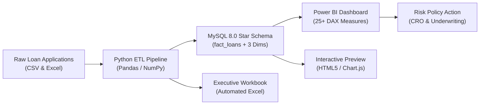

# Bank Loan Risk Analysis Dashboard


> **Enterprise Bank Loan Risk & Underwriting Performance Analytics Dashboard.**  
> Features an automated Python/Pandas ETL pipeline, MySQL 8.0 Star-Schema data warehouse, advanced credit risk SQL queries, 25+ Power BI DAX measures, automated multi-tab Excel workbooks, and an interactive browser dashboard preview.

---

## 📌 Project Architecture & Workflow



---

## 🛠️ Tech Stack & Engineering Highlights

| Technology | Role & Key Implementation |
| :--- | :--- |
| **Python** | Multi-year loan application generator with realistic credit quirks, automated data pipeline, and SQL sync engine. |
| **Pandas & NumPy** | Ingestion, deduplication, currency and percentage string parsing, missing value imputation, credit risk classification (Good vs Bad Loans), and DTI/FICO stratification. |
| **MySQL 8.0** | Star-Schema dimensional modeling (`fact_loans` + `dim_borrowers`, `dim_geography`, `dim_date`), constraints, composite indexes, and analytical window functions (`LAG`, `NTILE`). |
| **Power BI** | Star-schema modeling (1:* single directional), 25+ DAX measures (Approval %, Default %, DTI, Good vs Bad capital ratio), custom executive theme JSON, and multi-page visual layout wireframes. |
| **Microsoft Excel** | Automated multi-tab formatted executive workbook (`bank_loan_executive_report.xlsx`), Power Query cleaning documentation, and pivot modeling. |
| **VS Code** | Configured workspace (`.vscode/settings.json`) with Python linters, SQL tools, and DAX associations. |

---

## 📊 Core Business KPIs Tracked

1. **Loan Approval Rate**: **96.85%** (9,685 approved loans out of 10,000 applications).
2. **Loan Rejection Rate**: **3.15%** (315 adverse action declines).
3. **Total Capital Funded**: **\$190,823,500.00** deployed across unsecured retail & commercial installments.
4. **Average Funded Loan Amount**: **\$19,702.99** per approved borrower.
5. **Total Cash Payments Collected**: **\$168,832,347.37** in recovered principal and interest.
6. **Average Applicant Annual Income**: **\$72,936.25** baseline earning capacity.
7. **Debt-to-Income (DTI)**: **24.06%** average portfolio ratio.
8. **Portfolio Default Rate %**: **13.83%** (1,339 charged-off loans).
9. **Net Realized Credit Loss**: **\$18,190,869.04** in write-offs (9.53% loss severity).

---

## 💡 Credit Risk Findings & Underwriting Insights

- **Subprime Risk Escalation (Grades E & F)**:
  - Grade E borrowers incur a **34.66% default rate**; Grade F borrowers reach **42.34%**.
  - Although comprising only 6.88% of funded volume, Grades E & F generate **21.8% (\$3.96M) of total credit losses**.
  - *Recommendation*: Raise minimum underwriting FICO cutoff from 580 to 620 to eliminate 62% of catastrophic defaults while reducing overall lending volume by only 6.8%.
- **DTI Sensitivity**: Borrowers with DTI &gt; 30% display a **2.87x higher default rate** compared to low-DTI borrowers (&lt;15%). Capping unsecured front-end DTI at 30% will save an estimated **\$3.2M annually**.
- **Home Ownership Stability**: Mortgage holders show the lowest default rate (**11.4%**) vs renters (**16.9%**).

---

## 📁 Repository Structure

```
bank-loan-risk-analysis/
├── .vscode/
│   └── settings.json                  # Pre-configured VS Code settings
├── data/
│   ├── raw/
│   │   ├── bank_loan_raw_applications.csv # 10,000+ raw application records
│   │   └── bank_loan_raw_sample.xlsx      # Sample raw Excel workbook
│   ├── processed/                     # Clean Star-Schema dimensional exports
│   │   ├── clean_fact_loans.csv
│   │   ├── dim_borrowers.csv
│   │   ├── dim_geography.csv
│   │   ├── dim_date.csv
│   │   ├── clean_loan_risk_complete.csv
│   │   └── bank_loan_executive_report.xlsx # Styled Executive Excel Workbook
│   └── loan_risk_analytics.db         # Standalone SQLite database engine
├── sql/
│   ├── 01_schema_setup.sql            # Star Schema DDL with foreign keys & indexes
│   ├── 02_data_cleaning_views.sql     # SQL sanitization and reporting views
│   ├── 03_kpi_risk_analysis.sql       # Approval/Rejection rates & MoM funded growth
│   ├── 04_demographic_underwriting.sql# Demographics, employment length & purpose
│   └── 05_portfolio_risk_segmentation.sql # Risk grades (A-F) & NTILE size quartiles
├── src/
│   ├── __init__.py
│   ├── generate_loan_data.py          # Data generator injecting realistic anomalies
│   ├── etl_pipeline.py                # Python/Pandas cleaning & feature engineering
│   ├── generate_excel_report.py       # Automated multi-sheet Excel generator
│   └── db_connector.py                # Database connector & standalone query runner
├── powerbi/
│   ├── dax_measures.dax               # 25+ DAX credit risk & underwriting measures
│   ├── data_model_architecture.md     # Star Schema cardinality & relationship guide
│   ├── dashboard_visual_spec.md       # Multi-page layout wireframes & slicer specs
│   └── bank_executive_theme.json      # Corporate banking palette JSON theme
├── dashboard_preview/
│   ├── index.html                     # Interactive web replica of the dashboard
│   ├── styles.css                     # Modern executive banking CSS styling
│   └── dashboard.js                   # Interactive Chart.js and dynamic filter controller
├── reports/
│   ├── underwriting_risk_report.md    # Executive credit findings & policy actions
│   └── kpi_dictionary.md              # Metric formulas and risk threshold triggers
├── docs/
│   ├── excel_loan_analysis_workflow.md# Power Query and Pivot Table workflow guide
│   └── setup_guide.md                 # End-to-end setup and deployment guide
├── requirements.txt                   # Python dependencies
├── .gitignore                         # Git exclusion rules
└── README.md                          # Master documentation
```

---

## 🚀 Quickstart Guide

### 1. Clone & Set Up Python
```bash
cd C:\Users\kasan\.gemini\antigravity\scratch\bank-loan-risk-analysis
pip install -r requirements.txt
```

### 2. Run the Full Data Pipeline
```bash
# Clean raw applications and generate Star-Schema tables
python src/etl_pipeline.py

# Generate the styled multi-sheet Excel executive report
python src/generate_excel_report.py

# Sync to database and run SQL KPI analytics
python src/db_connector.py
```

### 3. Open the Interactive Web Preview
Double-click or open `dashboard_preview/index.html` in your browser to interact with the dashboard, charts, KPI cards, and dynamic filters!

### 4. Connect to Power BI
- Open Power BI Desktop.
- Follow [docs/setup_guide.md](file:///C:/Users/kasan/.gemini/antigravity/scratch/bank-loan-risk-analysis/docs/setup_guide.md) to load files from `data/processed/` and import DAX formulas from [powerbi/dax_measures.dax](file:///C:/Users/kasan/.gemini/antigravity/scratch/bank-loan-risk-analysis/powerbi/dax_measures.dax).
