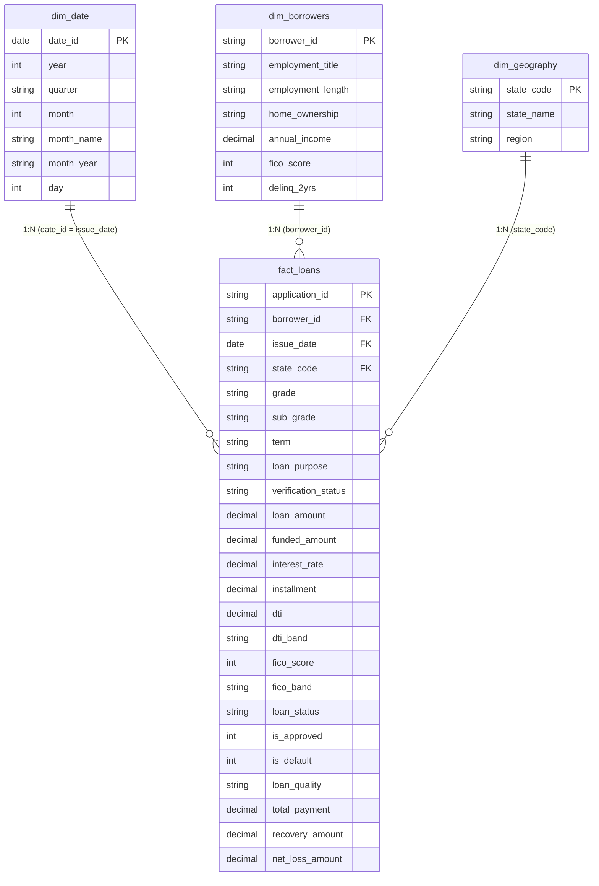

# Bank Loan Risk Data Model Architecture

## 1. Dimensional Star Schema Design
The data warehouse architecture is engineered in a pristine **Star Schema** optimized for high-volume in-memory VertiPaq analytics and real-time DAX performance in Power BI.

---

## 2. Relationships & Cardinality Configuration

| Dimension Table | Fact Table | Primary Key &rarr; Foreign Key | Cardinality | Filter Direction | Active |
| :--- | :--- | :--- | :--- | :--- | :--- |
| `dim_date` | `fact_loans` | `date_id` &rarr; `issue_date` | 1 : * (One-to-Many) | Single | **Active** |
| `dim_borrowers`| `fact_loans` | `borrower_id` &rarr; `borrower_id` | 1 : * (One-to-Many) | Single | **Active** |
| `dim_geography`| `fact_loans` | `state_code` &rarr; `state_code` | 1 : * (One-to-Many) | Single | **Active** |

### Modeling Principles:
1. **Single-Direction Filtering (1 &rarr; *)**: Ensures deterministic filter contexts and prevents circular model ambiguities.
2. **Date Table**: `dim_date` is marked as the official Date Table in Power BI for time-intelligence DAX functions (`SAMEPERIODLASTYEAR`, `DATEADD`, `TOTALYTD`).
3. **Optimized Data Types**: Floating point numeric values are stored as fixed decimal (`Currency` or `Decimal Number`) to eliminate floating-point rounding discrepancies.
